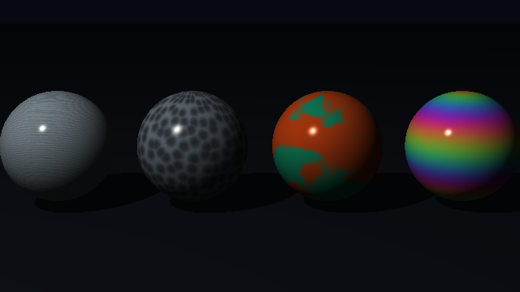

# RtDt user and developer guides

These documents describe the supported code on the repository's current `main` branch. The [README](../README.md) is the project front page.

## Getting started

- [CLI usage and options](CLI.md)
- [Quick reference](Quick-reference.md)
- [Scene file format and dependencies](Scene-files.md)
- [Create a scene and its assets](Scene-pack-creation.md)
- [RtDt .rdt job/pack format](RDT-pack-format.md)
- [Included sample scenes](Sample-scenes.md)
- [Browser deployment and verification](Deployment.md)

## Architecture and development

- [Current shared execution architecture](Architecture.md)
- [Render and animation control flow](Render-control-flow.md)
- [Node CLI internals](CLI-internals.md)
- [Coding style](Coding-style.md)
- [Native benchmarking and test targets](Benchmarking.md)
- [Cloud credentials and storage security](Cloud-credentials.md)

## Assets

- [OBJ meshes](OBJ-assets.md)
- [Image resources](Image-assets.md)
- [User asset directory](User-assets.md)

## Licensing

- [Community MIT licence](../LICENSE)
- [Community and separately licensed products](../LICENSING.md)
- [Lee Perry-Smith sample attribution](../samples/lee-perry-smith-head/LICENSE.txt)
