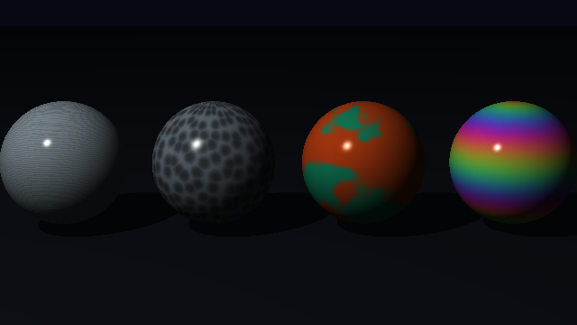

# RtDt sample scenes and packs

These repository scenes are supported by the declarative loader. Choose a featured scene in [the WebApp](../webapp.html), or pass its path using `node cli.js --scene-file FILE`.

| Scene | File | Notes |
| --- | --- | --- |
| Orbit Studio | [orbit.scene](../samples/orbit.scene) | Primitives and [AetherOre `.phy`](../samples/orbit/orbit-formula.phy); [192-frame `.rdt` pack](../samples/orbit.rdt) |
| Metal Finishes | [metal-finishes.scene](../samples/metal-finishes.scene) | Four deterministic procedural metal-look maps: brushed steel, hammered titanium, copper patina and anodized iridescence; [rendered preview](images/metal-finishes-preview.png) |
| Prism Garden | [prism-garden.scene](../samples/prism-garden.scene) | Reflective primitives |
| Cosmic Orbs | [cosmic-orbs.scene](../samples/cosmic-orbs.scene) | Celestial objects |
| Neon City | [neon-city.scene](../samples/neon-city.scene) | Buildings and reflective ground |
| Reflection Studio | [reflection-studio.scene](../samples/reflection-studio.scene) | Reflection and materials |
| Rocket to Rainbow Planet | [rocket-to-rainbow-planet.scene](../samples/rocket-to-rainbow-planet.scene) | Rocket OBJ geometry |
| Aurora Orrery | [aurora-orrery.scene](../samples/aurora-orrery.scene) | Orbital-ring OBJ meshes |
| Beetle Psychedelia | [vw-beetle-psychedelia.scene](../samples/vw-beetle-psychedelia.scene) | Car scene with private assets |
| Lee Perry-Smith head | [lee-perry-smith-head.scene](../samples/lee-perry-smith-head.scene) | UV/smooth-normal geometry; original photographic skin texture not bundled; [CC BY 3.0 attribution](../samples/lee-perry-smith-head/LICENSE.txt) |

A JSON/YAML scene example is also available at [orbit-yaml.scene.yaml](../samples/orbit-yaml.scene.yaml). The experimental procedural YAML language in `rtdt_scene_loader.js` is not equivalent to the supported declarative subset.

## Metal Finishes preview

The [Metal Finishes scene](../samples/metal-finishes.scene) generates its four surfaces in memory. This 640×360 CLI render shows brushed steel, hammered titanium, copper patina and anodized iridescence:

Scene-private assets normally live in a matching directory under `samples/`, e.g. `samples/rocket-to-rainbow-planet/`. Paths in each `.scene` are scene-relative. For a whole render job, prefer a [`.rdt` pack](RDT-pack-format.md).

Small previews are recommended for high-triangle meshes. See [scene creation](Scene-pack-creation.md).
